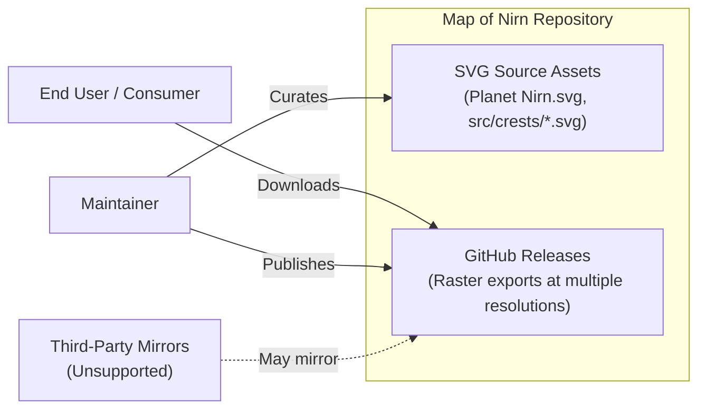
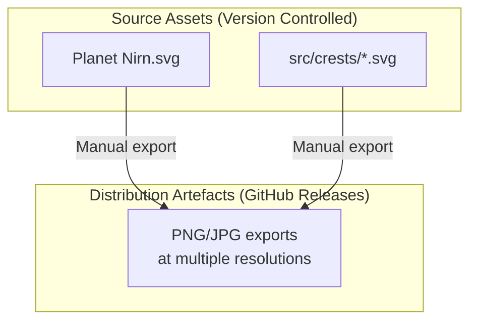
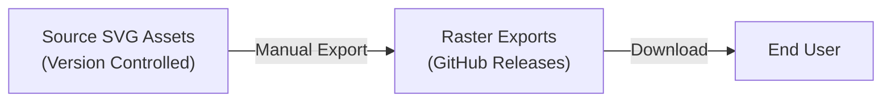
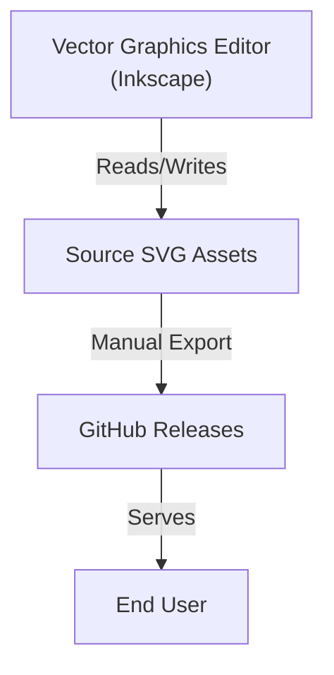

# Map of Nirn Architecture

This document describes the current architecture of the Map of Nirn repository, a static asset collection containing SVG map files and crest vectors for the world of Nirn from The Elder Scrolls universe. The repository contains no executable code, runtime dependencies, build processes, or network services.

## 📑 Table of Contents

- [Purpose](#purpose)
- [System Context](#system-context)
- [Architectural Style](#architectural-style)
- [Runtime Process](#runtime-process)
- [Architectural Areas](#architectural-areas)
- [Data Architecture](#data-architecture)
- [Interfaces and Integrations](#interfaces-and-integrations)
- [Dependency Direction and Rules](#dependency-direction-and-rules)
- [External Dependencies](#external-dependencies)
- [Deployment and Operations](#deployment-and-operations)
- [Compatibility Contracts](#compatibility-contracts)
- [Testing and Verification](#testing-and-verification)
- [Design Constraints](#design-constraints)
- [Source Map](#source-map)
- [Related Documentation](#related-documentation)

## 🎯 Purpose

This repository serves as a curated, high-resolution world map of Nirn (the main planet in The Elder Scrolls universe) and associated crest assets. Its principal responsibility is the distribution of static SVG and raster image assets for reference and browsing. The intended audience includes Elder Scrolls enthusiasts, modders, and content creators seeking canonical and community-sourced cartographic assets. This document records the repository's structural boundaries, asset organisation, and distribution model.

## 🌐 System Context

The repository is a content-only collection with no runtime execution. Its boundaries are defined by the GitHub repository and its release artefacts.

The principal external boundaries are:
- **GitHub Releases:** Primary distribution channel for raster map exports at multiple resolutions; owned and published by maintainers.
- **GitHub Repository (source):** Canonical location for SVG source assets; maintained by the project maintainers.
- **Third-party mirrors:** Unofficial redistribution channels; not maintained or endorsed by the project.

## 🏗️ Architectural Style

The repository follows a **static asset repository** pattern: a version-controlled collection of source assets (SVG) with derived distribution artefacts (raster images) published via GitHub Releases. There is no build pipeline, runtime, or executable component. The principal consequence is that all changes are direct edits to source SVG files, and distribution artefacts are manually produced and uploaded by maintainers.

The principal architecture boundaries are:
- **Source Assets (`Planet Nirn.svg`, `src/crests/`):** Canonical vector sources; edited directly using vector graphics editors (e.g., Inkscape).
- **Distribution Artefacts (GitHub Releases):** Raster exports produced manually from source assets; no automated transformation.

## 🔄 Runtime Process

This repository has no runtime process. There is no application startup, execution, or service lifecycle. The only "processes" are human-driven maintenance workflows:

1. **Asset revision:** Maintainer edits SVG source files in a vector graphics editor.
2. **Export validation:** Maintainer validates raster exports in an image viewer.
3. **Release publication:** Maintainer creates a GitHub Release with updated raster artefacts.

## 🗂️ Architectural Areas

### Map Source

Paths:
- `Planet Nirn.svg`

Responsibilities:
- Primary world map vector source containing landmasses, regions, and crest placements.

Boundary rules:
- Edited only with Inkscape-compatible SVG features.
- No external dependencies or build-time transformations.

### Crest Assets

Paths:
- `src/crests/`

Responsibilities:
- Scalable vector crest assets used on the map (city, hold, and faction symbols).

Boundary rules:
- Each crest is an independent SVG file.
- Maintain consistent SVG structure and naming conventions.
- Use Inkscape-compatible SVG features only.

### Release Artefacts

Paths:
- GitHub Releases (not in repository)

Responsibilities:
- Raster image exports (PNG/JPG) at multiple resolutions for end-user consumption.

Boundary rules:
- Produced manually from source assets.
- No automated generation or CI pipeline.

## 💾 Data Architecture

The repository manages two categories of data: source vector assets and distribution raster assets.

| Data or Store | Owner | Representation and Storage | Lifecycle or Consistency |
|---------------|-------|----------------------------|--------------------------|
| `Planet Nirn.svg` | Maintainer | SVG (XML-based vector format) in repository root | Mutable; revised directly; versioned via Git |
| `src/crests/*.svg` | Maintainer | Individual SVG files in `src/crests/` directory | Mutable; added/revised directly; versioned via Git |
| Release raster assets | Maintainer | PNG/JPG files attached to GitHub Releases | Immutable per release tag; new releases supersede |

## 🔌 Interfaces and Integrations

| Interface or Integration | Direction | Contract | Owner | Failure Semantics |
|--------------------------|-----------|----------|-------|-------------------|
| GitHub Releases | Outbound | HTTPS download of raster assets | Maintainer | Download fails; user retries or reports issue |
| GitHub Repository (source) | Bidirectional | Git clone/pull/push of SVG sources | Maintainer | Network/auth failure; standard Git recovery |
| Vector graphics editor (Inkscape) | Inbound | SVG 1.1 / Inkscape-extended SVG | Maintainer | Editor incompatibility; manual correction required |

## 🧭 Dependency Direction and Rules

The principal dependency rules are:
- Source assets have no dependencies on distribution artefacts or external services.
- Distribution artefacts depend solely on source assets (manual transformation).
- No automated build, CI, or transformation pipeline exists.
- Vector graphics editor is the only external tool dependency for maintenance.

## 📦 External Dependencies

| Dependency | Responsibility | Integration Boundary | Architectural Consequence |
|------------|----------------|----------------------|---------------------------|
| Inkscape (or compatible SVG editor) | Authoring and editing SVG source assets | Maintainer's local environment | Source assets must use Inkscape-compatible SVG features; no runtime dependency |
| GitHub | Hosting, version control, release distribution | Repository and Releases | Centralised distribution; no self-hosting infrastructure |
| Image viewer | Validation of raster exports | Maintainer's local environment | No architectural impact; manual verification only |

## 🚀 Deployment and Operations

| Concern | Current Design | Architectural Consequence |
|---------|----------------|---------------------------|
| Process topology | None (static assets only) | No services, daemons, or processes to operate |
| Deployment unit | GitHub Repository + GitHub Releases | Single source of truth; releases are immutable snapshots |
| Persistent state | Git history (source); Release artefacts (distribution) | Full asset history in Git; releases provide fixed download targets |
| Scaling assumptions | N/A (static file serving via GitHub CDN) | GitHub handles bandwidth and availability |
| Startup/shutdown responsibilities | N/A | No operational procedures |
| Operator-visible outputs | Release notes, asset files | Maintainer authors release notes manually |

## 🛡️ Compatibility Contracts

| Contract | Owner | Invariant | Verification | Change Policy |
|----------|-------|-----------|--------------|---------------|
| SVG source format | Maintainer | Inkscape-compatible SVG 1.1 | Manual validation in Inkscape | Backward-compatible edits only; breaking changes require new major version |
| Release asset naming | Maintainer | Consistent resolution identifiers in filenames | Manual review at release | Stable naming scheme; changes documented in release notes |
| Crest file naming | Maintainer | `<Location Name>.svg` pattern in `src/crests/` | Manual review | Stable pattern; new crests follow existing convention |

## ✅ Testing and Verification

No automated test suite exists. Verification is manual:

- **Source validation:** Open `Planet Nirn.svg` and `src/crests/*.svg` in Inkscape; verify structure, layer organisation, and rendering.
- **Export validation:** Open generated raster exports in an image viewer; verify resolution, colour fidelity, and absence of artefacts.
- **Release validation:** Confirm all advertised resolutions are present in the GitHub Release assets.

## ⚠️ Design Constraints

- **No build pipeline:** All transformations are manual; this limits reproducibility but eliminates CI/CD complexity.
- **Single-source editing:** Source assets are edited directly in a vector graphics editor; no intermediate formats or tooling.
- **Manual release process:** Maintainer manually exports, validates, and uploads raster artefacts for each release.
- **No runtime:** The repository is purely a content distribution mechanism; no execution environment is involved.
- **Canonical accuracy vs. community content:** Certain regions use community-sourced content where canon sources are unavailable; this is documented in README.md Known Limitations.

## 🗺️ Source Map

| Area | Path |
|------|------|
| Primary map source | `Planet Nirn.svg` |
| Crest vector assets | `src/crests/` |
| Documentation | `README.md`, `CONTRIBUTING.md`, `SECURITY.md`, `PRIVACY.md`, `CODE_OF_CONDUCT.md` |
| Funding configuration | `.github/FUNDING.yml` |

## 📚 Related Documentation

- [README.md](./README.md) — Project overview, usage, obtaining assets, development setup, and project structure.
- [CONTRIBUTING.md](./CONTRIBUTING.md) — Contribution guidelines, issue reporting, enhancement suggestions, and code contribution process.
- [SECURITY.md](./SECURITY.md) — Security policy, supported versions, vulnerability reporting, scope, and disclosure policy.
- [PRIVACY.md](./PRIVACY.md) — Privacy and data handling statement.
- [CODE_OF_CONDUCT.md](./CODE_OF_CONDUCT.md) — Community conduct standards.