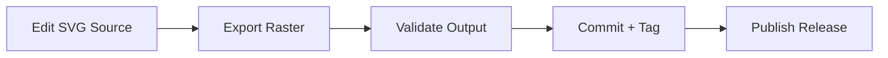

# Build and Deployment

## Overview

This document describes the manual build (export) and deployment (release) workflow for the Map of Nirn repository. There is no automated CI/CD pipeline; all steps are human-driven using Inkscape and the GitHub web interface or `gh` CLI.

## Build Pipeline

### Stage 1: Source Preparation

| Step | Action | Tool |
|------|--------|------|
| 1 | Open `Planet Nirn.svg` or crest SVG in Inkscape | Inkscape |
| 2 | Apply edits (geography, labels, crest anchors) | Inkscape |
| 3 | Save as SVG 1.1 with Inkscape extensions | Inkscape |
| 4 | Verify SVG opens without errors | Inkscape |

### Stage 2: Raster Export

| Target | Resolution | Format | Inkscape DPI Setting |
|--------|------------|--------|----------------------|
| 4K | 3840×2160 | PNG, JPG | Calculated from viewBox |
| 1080p | 1920×1080 | PNG, JPG | Calculated from viewBox |
| 720p | 1280×720 | PNG, JPG | Calculated from viewBox |
| Thumbnail | 400×225 | PNG | Calculated from viewBox |

**Export procedure (per asset, per resolution):**

1. Open source SVG in Inkscape.
2. `File → Export PNG Image` (or `Export As` for JPG).
3. Set export width in pixels to match target resolution.
4. Export to a staging directory.
5. Repeat for each format and resolution.

### Stage 3: Validation

| Check | Method | Pass Criteria |
|-------|--------|---------------|
| Pixel dimensions | Image viewer / `identify` (ImageMagick) | Exact match to target resolution |
| Visual fidelity | Manual inspection | No clipping, artefacts, or missing layers |
| File integrity | Opens in standard image viewers | No corruption |
| File size sanity | Manual review | Within expected range for resolution |
| Checksum generation | `sha256sum <file>` | Recorded for release notes |

### Stage 4: Commit and Tag

| Step | Command/Action |
|------|----------------|
| 1 | `git add src/` (and any changed files) |
| 2 | `git commit -m "descriptive message"` |
| 3 | `git tag -a v{major}.{minor}.{patch} -m "Release description"` |
| 4 | `git push origin master --tags` |

### Stage 5: Release Publication

| Step | Action | Tool |
|------|--------|------|
| 1 | Create GitHub Release for the tag | GitHub web UI or `gh release create` |
| 2 | Write release notes (changes, new assets, checksums) | GitHub web UI |
| 3 | Upload all raster exports as release assets | GitHub web UI or `gh release upload` |
| 4 | Verify all assets download correctly | Browser / `gh release view` |
| 5 | Verify checksums match published values | `sha256sum` on downloaded files |

## Release Asset Naming Convention

| Asset Type | Pattern | Example |
|------------|---------|---------|
| Map (PNG) | `map-of-nirn-{resolution}.png` | `map-of-nirn-4k.png` |
| Map (JPG) | `map-of-nirn-{resolution}.jpg` | `map-of-nirn-1080p.jpg` |
| Crest (PNG) | `crest-{faction-name}-{resolution}.png` | `crest-aldmeri-dominion-4k.png` |
| Crest (JPG) | `crest-{faction-name}-{resolution}.jpg` | `crest-aldmeri-dominion-1080p.jpg` |

## Deployment Targets

| Target | Method | Consumers |
|--------|--------|-----------|
| GitHub Releases | Release asset upload | Direct downloaders, mod communities |
| GitHub CDN | Automatic via Releases | Embedded usage, hotlinking |
| Repository `master` | `git push` | Source cloners, contributors |

## Rollback Procedure

Published releases are immutable; rollback means publishing a corrected release:

| Step | Action |
|------|--------|
| 1 | Identify the defect in the released artefact |
| 2 | Fix the source SVG |
| 3 | Re-run the full export + validation pipeline |
| 4 | Commit and tag a patch version (`v{major}.{minor}.{patch+1}`) |
| 5 | Publish a new release noting the correction |

## Prerequisites

| Requirement | Version | Purpose |
|-------------|---------|---------|
| Inkscape | 1.x | SVG editing and raster export |
| Git | Any recent | Version control |
| GitHub account | With release permissions | Publishing releases |
| Image viewer / ImageMagick | Any recent | Validation |
| `sha256sum` (coreutils) | Any | Checksum generation |

## Cross-References

- [State and Persistence](state-and-persistence.md)
- [Testing](testing.md)
- [Troubleshooting](troubleshooting.md)
- [Invariants](invariants.md#distribution-invariants)