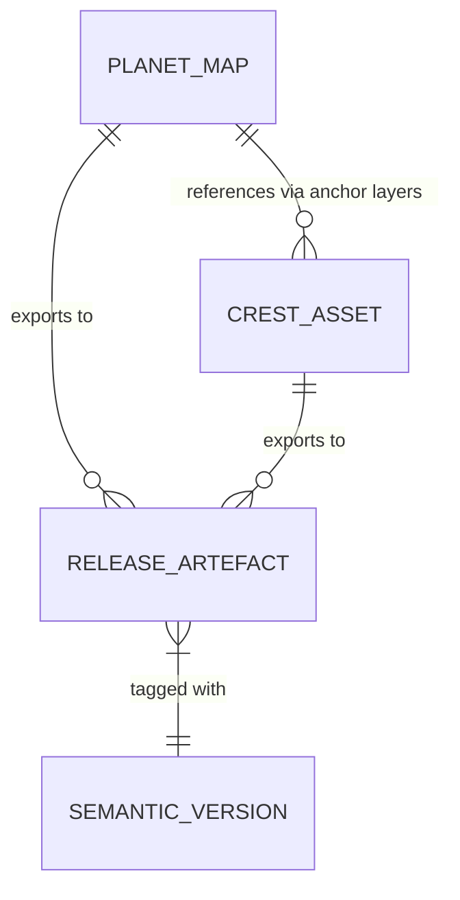

# Data Model

## Overview

This document describes the domain entities, their relationships, and persistence characteristics for the Map of Nirn repository. As a static asset repository, the "data model" consists of SVG source files and their exported raster derivatives rather than traditional database entities.

## Domain Entities

### Planet Map (Primary Asset)

| Property | Description |
|----------|-------------|
| **Canonical Name** | `Planet Nirn.svg` |
| **Format** | SVG 1.1 with Inkscape extensions |
| **Role** | Single source of truth for the world map |
| **Layers** | Base geography, political boundaries, labels, crest anchors, non-canon markers |
| **Dimensions** | Vector (resolution-independent) |
| **Colour Space** | sRGB |
| **Versioning** | Git history + semantic version tags |

### Crest Assets (Secondary Assets)

| Property | Description |
|----------|-------------|
| **Canonical Location** | `src/crests/` |
| **Format** | SVG 1.1 with Inkscape extensions |
| **Count** | 30 crest files |
| **Naming Pattern** | `{faction-name}.svg` (kebab-case) |
| **Role** | Faction/heraldic symbols referenced by the planet map |
| **Dimensions** | Vector (resolution-independent) |
| **Colour Space** | sRGB |
| **Versioning** | Git history + semantic version tags |

### Release Artefacts (Distribution Assets)

| Property | Description |
|----------|-------------|
| **Formats** | PNG (lossless), JPG (compressed) |
| **Resolutions** | 4K (3840×2160), 1080p (1920×1080), 720p (1280×720), Thumbnail (400×225) |
| **Naming Convention** | `map-of-nirn-{resolution}.{png,jpg}` |
| **Crest Exports** | `crest-{faction-name}-{resolution}.{png,jpg}` |
| **Storage** | GitHub Releases (immutable once published) |
| **Checksums** | SHA-256 published in release notes |

## Entity Relationships

### Relationship Details

| Relationship | Cardinality | Description |
|--------------|-------------|-------------|
| Planet Map → Crest Assets | 1 : Many | Planet map contains anchor layers that position crests; crests are separate source files |
| Planet Map → Release Artefacts | 1 : Many | Single source exports to multiple resolutions/formats |
| Crest Asset → Release Artefacts | 1 : Many | Each crest exports to multiple resolutions/formats |
| Release Artefact → Semantic Version | Many : 1 | All artefacts in a release share the same version tag |

## Persistence Model

### Git Repository (Source of Truth)

| Aspect | Detail |
|--------|--------|
| **Storage** | Git objects (blobs, trees, commits) |
| **Branching** | Single `master` branch |
| **Tagging** | Semantic version tags (`v{major}.{minor}.{patch}`) |
| **History** | Full revision history for all SVG sources |
| **Immutability** | Commits are immutable; tags are immutable |

### GitHub Releases (Distribution Layer)

| Aspect | Detail |
|--------|--------|
| **Storage** | GitHub Release assets (CDN-backed) |
| **Immutability** | Release assets are immutable once published |
| **Retention** | Permanent (subject to GitHub ToS) |
| **Access** | Public HTTPS URLs with CDN caching |
| **Checksums** | SHA-256 verified at upload time |

## Attribute Specifications

### Planet Map Attributes

| Attribute | Type | Constraints | Example |
|-----------|------|-------------|---------|
| `fileName` | String | Fixed: `Planet Nirn.svg` | `Planet Nirn.svg` |
| `width` | Integer (px) | Vector (no fixed width) | N/A |
| `height` | Integer (px) | Vector (no fixed height) | N/A |
| `viewBox` | String | SVG viewBox attribute | `0 0 4000 2250` |
| `layers` | Array[String] | Defined layer names | `["base", "political", "labels", "crest-anchors", "non-canon"]` |
| `crestAnchors` | Array[Object] | Position + crest reference | `[{id: "crest-aldmeri", x: 1200, y: 800, crest: "aldmeri-dominion.svg"}]` |
| `nonCanonMarkers` | Array[Object] | Position + description | `[{id: "fan-location", x: 500, y: 500, note: "Community addition"}]` |

### Crest Asset Attributes

| Attribute | Type | Constraints | Example |
|-----------|------|-------------|---------|
| `fileName` | String | Kebab-case, `.svg` suffix | `aldmeri-dominion.svg` |
| `factionName` | String | Human-readable name | `Aldmeri Dominion` |
| `viewBox` | String | SVG viewBox attribute | `0 0 200 200` |
| `colours` | Array[String] | Hex colour codes | `["#FFD700", "#000000", "#FFFFFF"]` |
| `isCanon` | Boolean | True = lore-accurate | `true` |

### Release Artefact Attributes

| Attribute | Type | Constraints | Example |
|-----------|------|-------------|---------|
| `fileName` | String | Pattern: `map-of-nirn-{res}.{ext}` | `map-of-nirn-4k.png` |
| `sourceAsset` | String | `Planet Nirn.svg` or crest filename | `Planet Nirn.svg` |
| `format` | Enum | `png` \| `jpg` | `png` |
| `resolution` | Enum | `4k` \| `1080p` \| `720p` \| `thumb` | `4k` |
| `width` | Integer | Pixels | `3840` |
| `height` | Integer | Pixels | `2160` |
| `fileSize` | Integer | Bytes | `12451842` |
| `sha256` | String | 64-char hex | `a1b2c3d4...` |
| `version` | String | Semantic version | `v1.2.0` |

## Invariants

| Invariant | Verification Method |
|-----------|---------------------|
| Every crest referenced in planet map anchors exists in `src/crests/` | Manual cross-reference check |
| Every crest in `src/crests/` is referenced by at least one anchor (or documented as unused) | Inventory audit |
| Release artefacts match source SVG dimensions at target resolution | Pixel dimension validation |
| SHA-256 checksums match published values | `sha256sum` verification |
| Semantic version tags are monotonic | Git tag sort verification |
| No release asset is modified after publication | GitHub Release immutability |

## Versioning Strategy

| Component | Scheme | Authority |
|-----------|--------|-----------|
| Source SVGs | Git commit history + semantic tags | Repository maintainer |
| Release artefacts | Semantic version (aligned with source tag) | Release publisher |
| Crest inventory | Implicit via Git history | Repository maintainer |

## Migration and Evolution

| Scenario | Approach |
|----------|----------|
| New crest added | Add SVG to `src/crests/`, add anchor to planet map, tag new version |
| Crest redesigned | Replace SVG in `src/crests/`, update anchor if dimensions change, tag new version |
| Map geography changed | Edit `Planet Nirn.svg`, tag new version |
| New export resolution needed | Add to export checklist, regenerate all release artefacts for next version |
| Format change (e.g., WebP) | Add format to export pipeline, publish in next release |

## Cross-References

- [Architecture Overview](../ARCHITECTURE.md#architectural-areas)
- [Source Map](source-map.md#asset-relationship-graph)
- [Invariants](invariants.md#distribution-invariants)
- [Repository Structure](repository-structure.md#asset-inventory)