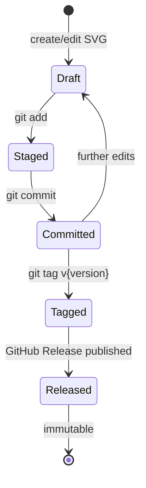

# State and Persistence

## Overview

This document describes how state is created, stored, and evolved across the Map of Nirn repository. As a static asset repository, all persistent state lives in Git objects and GitHub Releases; there is no runtime state, database, or mutable server-side storage.

## State Categories

| Category | Storage | Mutability | Lifetime |
|----------|---------|------------|----------|
| Source asset state | Git repository (working tree + history) | Mutable until committed | Permanent (Git history) |
| Release state | GitHub Releases | Immutable once published | Permanent |
| Working state | Local filesystem (uncommitted changes) | Mutable | Until commit or discard |
| Documentation state | Git repository | Mutable until committed | Permanent (Git history) |

## State Lifecycle

### Source Asset Lifecycle

| State | Description | Transitions |
|-------|-------------|-------------|
| **Draft** | SVG being edited in Inkscape; changes exist only in working tree | → Staged (via `git add`) |
| **Staged** | Changes marked for commit; not yet permanent | → Committed (via `git commit`), → Draft (via `git restore --staged`) |
| **Committed** | Changes permanently recorded in Git history | → Draft (further edits), → Tagged (via `git tag`) |
| **Tagged** | Commit marked with semantic version | → Released (via GitHub Release) |
| **Released** | Raster exports published to GitHub Releases; immutable | Terminal state |

### Release Artefact Lifecycle

| State | Description | Transitions |
|-------|-------------|-------------|
| **Exported** | Raster file generated locally from SVG source | → Validated |
| **Validated** | Dimensions, format, and checksum verified | → Published |
| **Published** | Uploaded to GitHub Release; immutable | Terminal state |

## Persistence Mechanisms

### Git Repository

| Aspect | Detail |
|--------|--------|
| **Object model** | Blobs (file contents), trees (directory structure), commits (snapshots) |
| **Branching** | Single `master` branch; no feature branches required for solo maintenance |
| **Tagging** | Annotated semantic version tags (`v{major}.{minor}.{patch}`) |
| **History integrity** | SHA-1/SHA-256 content-addressed storage; tamper-evident |
| **Remote** | GitHub origin; push publishes commits and tags |

### GitHub Releases

| Aspect | Detail |
|--------|--------|
| **Asset storage** | CDN-backed, immutable after publication |
| **Metadata** | Release title, tag, description, checksums in release notes |
| **Access** | Public HTTPS download URLs |
| **Deletion policy** | Releases are never deleted or modified; corrections require a new release |

## State Transitions and Rules

### Commit Rules

| Rule | Rationale |
|------|-----------|
| One logical change per commit | Keeps history reviewable and revertible |
| Descriptive commit messages | Future maintainers can understand intent |
| No secrets or personal data in commits | Security and privacy policy |
| SVG sources committed as text-diffable XML | Enables meaningful diffs |

### Tagging Rules

| Rule | Rationale |
|------|-----------|
| Tags follow semantic versioning | Consumers can reason about compatibility |
| Tags are annotated (not lightweight) | Carries tagger identity and message |
| Tags are never moved or deleted | Immutability contract with consumers |
| Major version bumps for canon-breaking changes | Signals downstream impact |

### Release Rules

| Rule | Rationale |
|------|-----------|
| Release tag must match a source commit tag | Traceability from artefact to source |
| All artefacts in a release share one version | Consistency |
| SHA-256 checksums published in release notes | Integrity verification by consumers |
| Published releases are never edited | Immutability contract |

## State Recovery

| Scenario | Recovery Method |
|---------|-----------------|
| Accidental deletion of working file | `git checkout -- <file>` (restores last committed version) |
| Bad commit on `master` | New corrective commit (never rewrite history) |
| Corrupted local clone | Re-clone from GitHub origin |
| Missing release asset | Re-export from tagged source commit; verify checksum |
| Lost tag reference | `git fetch --tags` from origin |

## Concurrency and Consistency

| Concern | Approach |
|---------|----------|
| Concurrent edits | Single-maintainer model; conflicts resolved manually if collaborators join |
| Source-release consistency | Releases always reference a tagged commit; never uncommitted state |
| Checksum consistency | Checksums computed at export time and verified at upload time |

## Cross-References

- [Data Model](data-model.md)
- [Build and Deployment](build-and-deployment.md)
- [Invariants](invariants.md#process-invariants)
- [Design Decisions](design-decisions.md)